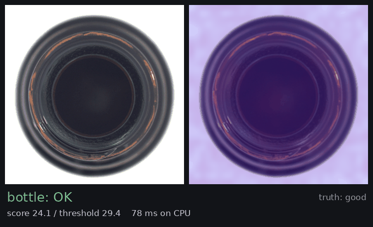

# edge-inspection

Industrial visual inspection on MVTec AD, taken all the way to a CPU service: four anomaly detectors
evaluated with my own metric code, eleven runtimes benchmarked on the same test set, an INT8 path that
keeps its accuracy, a threshold that comes from the line instead of the test set, and a FastAPI service
in Docker with CI, drift stats and Prometheus metrics.



*Real HTTP calls to the service on CPU: part, returned heatmap, verdict against the calibrated threshold.
The last frame is a miss (see [limitations](#limitations)).*

## Results at a glance

| | image AUROC | pixel AUROC | AUPRO | latency |
|---|---|---|---|---|
| PatchCore (WRN50, 10% coreset), all good train images, + inspection region | **98.8** | **98.0** | **93.0** | 26.5 ms GPU fp32 |
| PatchCore paper (224 center crop) | 99.0 | 98.1 | 93.5 | |
| Same model on TensorRT fp16 | 98.1 * | 98.0 | 92.7 | **5.2 ms** GPU |
| Deployed service: OpenVINO INT8 on CPU, PIL preprocessing, ROI | 98.6 | 98.0 | 92.8 | 94 ms CPU (68 ms INT8 graph) |

Means over all 15 categories. \* runtime rows use the model trained on 90% of the good images (the other
10% calibrate the threshold) and no ROI, so they compare to its FP32 score of 98.1.

## What is in here

| | |
|---|---|
| `edgeinspect/metrics.py` | image AUROC, pixel AUROC, AUPRO (exact, FPR limit 0.3, matches anomalib within 2e-3, tested) |
| `edgeinspect/evaluate.py` | scores raw model outputs (anomalib's post-processor off), at 256 px |
| `edgeinspect/roi.py` | inspection region: score the part, not the background |
| `edgeinspect/serving.py` | the deployed path, no torch: PIL resize, OpenVINO, ROI, verdict |
| `bench/train.py` | PatchCore, PaDiM, EfficientAD, WinCLIP via anomalib 2.1 |
| `bench/runtimes.py` | 11 runtimes on the full test set: accuracy and latency |
| `bench/int8_bank.py` | rebuilds the PatchCore memory bank from INT8 features |
| `bench/crossfit.py`, `bench/thresholds.py` | where the threshold should come from |
| `bench/deploy.py` | builds `deploy/<category>/` with a label-free INT8 acceptance gate |
| `serve/` | FastAPI app, dashboard; `Dockerfile`; `.github/workflows/ci.yml` builds and smoke-tests the image |

## Evaluation protocol

- MVTec AD, all 15 categories. Images resized to 256 px (no center crop), masks evaluated at 256 px.
- Out of the box anomalib validates on the test set, so thresholds and EfficientAD's map normalisation
  quantiles are tuned on test images. Here validation is off, and the quantiles come from held-out good
  training images.
- A calibration split: 10% of each category's good training images (at least 10) is held out and never
  trained on (`results/calib_split.json`). The "calibrated" operating point uses only these images.
- The "full train" rows use every good training image, like the papers.

## 1. Model comparison

| model | image AUROC | pixel AUROC | AUPRO | GPU ms | fit |
|---|---|---|---|---|---|
| PatchCore, WRN50 layer 2+3, 10% coreset | 98.1 | 98.0 | 92.7 | 28.8 | 130 s |
| PatchCore, full train | 98.2 | 98.0 | 92.7 | 30.8 | 161 s |
| PatchCore, full train + ROI | 98.8 | 98.0 | 93.0 | | |
| PaDiM, ResNet18 | 89.0 | 96.2 | 89.5 | 2.7 | 3 s |
| EfficientAD-S, 10k steps | EFFAD_IMG | EFFAD_PIX | EFFAD_PRO | EFFAD_MS | EFFAD_FIT |
| WinCLIP, zero shot (no training images) | 90.3 | 82.4 | 62.1 | 668 | |

Per category tables: `python bench/summarize.py`. WinCLIP lands near its paper (91.8 / 85.1 / 64.6).

EFFAD_NOTE

**Resolution.** At 320 px, screw AUPRO goes 93.5 to 96.3 and pill 94.8 to 95.9, but image AUROC does not
move (96.8 to 96.4, 94.7 to 95.0) and GPU latency is 2.4x. 256 stays the default.

## 2. Why toothbrush scored 91.7: the background

Three good toothbrush images scored like defects. The anomaly maps all lit up the same place, the black
background at the bottom right, and the crop shows why: a loose red bristle lying next to the brush.
PatchCore is right that something unusual is in the frame; MVTec labels the part.

The fix is what a production cell does with dust on a fixture: an inspection region (`edgeinspect/roi.py`).
ROI = this image's part mask (pixels that differ from the border colour, largest blob) OR a template
(union of part masks over the good training images, so a missing part still sits inside it). Textures
and objects that fill the frame use the whole image. Nothing is built from test images.

| category | image AUROC | AUPRO | defect pixels outside ROI |
|---|---|---|---|
| toothbrush | 91.7 → **100** | 88.0 → 90.7 | 0.5% |
| capsule | 99.3 → 99.1 | 92.4 → 93.6 | 0 |
| pill | 95.3 → 94.8 | 94.9 → 95.3 | 0 |
| hazelnut | 100 → 100 | 94.9 → 94.9 | 0 |

The 224 center crop the PatchCore paper uses does not explain the gap (91.9 with the crop).

## 3. Runtimes

Same model (90% split), full test set of every category, batch 1 latency, RTX 3060 Laptop and the
laptop's CPU (8 threads).

| runtime | image AUROC | pixel AUROC | AUPRO | worst category AUPRO change | median ms |
|---|---|---|---|---|---|
| PyTorch CUDA fp32 | 98.1 | 98.0 | 92.7 | 0.0 | 26.5 |
| PyTorch CUDA fp16 | 98.1 | 98.0 | 92.7 | 0.0 | 11.8 |
| ONNX Runtime CUDA fp32 | 98.1 | 98.0 | 92.7 | 0.0 | 22.5 |
| ONNX Runtime TensorRT fp16 | 98.1 | 98.0 | 92.7 | 0.1 | **5.2** |
| PyTorch CPU fp32 | 98.1 | 98.0 | 92.7 | 0.0 | 269 |
| ONNX Runtime CPU fp32 | 98.1 | 98.0 | 92.7 | 0.0 | 194 |
| OpenVINO CPU fp32 | 98.1 | 98.0 | 92.7 | 0.0 | 174 |
| OpenVINO INT8, whole graph (NNCF default) | 92.7 | 95.9 | 85.1 | 25.0 | 78 |
| OpenVINO INT8, weights only | 98.0 | 97.9 | 92.4 | 1.2 | 174 |
| OpenVINO INT8, anomaly head kept fp32 | 95.1 | 97.4 | 90.5 | 11.8 | 81 |
| ... + memory bank rebuilt from INT8 features | 97.7 | 97.9 | 92.4 | 1.5 | **68** |
| **service** (gated INT8, PIL, ROI, end to end) | **98.6** | **98.0** | **92.8** | | 94 |

Two things went wrong on the way, and both were silent:

- **ONNX Runtime's CUDA and TensorRT providers fell back to CPU** because `libcublasLt.so.12` and
  `libnvinfer` were not on the loader path. The session still ran and returned the right scores, just at
  CPU speed. Now the pip CUDA and TensorRT libraries are preloaded and `OnnxPredictor` raises if the
  session is not on the provider it was asked for.
- **INT8 took capsule from 97.2 to 64.2 image AUROC.** Not the head: keeping distances, upsampling and
  blur in fp32 (which is what rescued bottle's AUPRO) left capsule at 64.2. Not the k-NN MatMul either (fp32 MatMul: still 64.7).
  The cause is a mismatch. The memory bank holds fp32 embeddings, the INT8 backbone produces slightly
  different ones, and for small defects that offset is the whole signal. Selecting the coreset from the
  INT8 backbone's own embeddings (`bench/int8_bank.py`) brings capsule back to 97.1 at 61 ms.

**INT8 acceptance gate.** Screw still lost 6 points after the rebuild. Deciding that from test AUROC
would be tuning on the test set, so `bench/deploy.py` uses a label-free check: on the calibration images
the INT8 scores must stay within 5% of fp32. Screw is 10.9% off, every other category at most 4.7%
(capsule), so screw ships fp32 (245 ms) and the other 14 ship INT8.

## 4. Where the threshold comes from

A score is only useful with a threshold. The calibration split gives 21 to 39 good images per category,
and three ways to set one were compared. Cells are false alarm rate / miss rate in %, mean over 15
categories (`python bench/thresholds.py --tag patchcore`):

| protocol | max of calibration scores | mean + 2.33 SD |
|---|---|---|
| A: held-out good training images (10% split) | 11.4 / 9.1 | 10.6 / 7.2 |
| B: out-of-fold scores of all good training images (5-fold cross fit) | 2.3 / 20.1 | 7.9 / 7.6 |
| C: field calibration, half of the good *test* parts, scored on the other half (50 splits), with ROI | 6.6 / 8.7 | **4.2 / 7.6** |
| oracle: best F1 threshold picked on the test set | 8.3 / 1.4 | |

What drives it is a capture-session shift, not too few samples. On leather, good test parts score 2.2 SD
above good training parts, so any threshold from the training session flags 47% of good leather. More
training-session data (B, 10x the images) does not fix that; with the SD rule carpet and wood get
worse (11 → 21%, 16 → 26% false alarms). A few good parts
from the line do (C: leather 47% → 3%). So the service has `POST /calibrate/{category}`: send 10 or more
known-good parts, the threshold becomes mean + 2.33 SD of their scores, and the drift baseline resets.

The misses that are left are model limits, mostly pill (28%) and screw (27%), the two categories with the
lowest AUROC.

## 5. The service

```
python bench/deploy.py --categories all --out deploy      # gated INT8 or fp32 graph, ROI, meta.json
MODELS_DIR=deploy uvicorn serve.app:app --port 8000
curl -F file=@part.png "localhost:8000/inspect/bottle?heatmap=true"
```

| endpoint | |
|---|---|
| `POST /inspect/{category}` | image in; score, threshold, verdict, latency, optional heatmap PNG |
| `POST /calibrate/{category}` | 10+ known-good images; new threshold |
| `GET /stats`, `GET /metrics` | rolling flag rate, drift z (window median vs calibration, in SDs), latency p50/p95; Prometheus text |
| `GET /` | small live dashboard |

The image has no torch: numpy, Pillow, SciPy, OpenVINO, FastAPI. `bench/runtimes.py` scores this exact
path on the full test set (the "service" row). CI runs the tests without MVTec or torch (a tiny OpenVINO
model built in code), then builds the Docker image and checks a real request against the running
container.

## Reproduce

```
uv venv ~/venvs/inspect && uv pip install torch==2.11.0 torchvision==0.26.0 --index-url https://download.pytorch.org/whl/cu128
uv pip install "anomalib[core]==2.1.*" openvino==2026.4.1 nncf onnxruntime-gpu tensorrt-cu12-libs fastapi uvicorn
python bench/train.py --model patchcore --categories all            # 90% split, calibrated threshold
python bench/train.py --model patchcore --full-train --categories all
python bench/crossfit.py --model patchcore --folds 5
python bench/roi_study.py --tag patchcore_fulltrain
python bench/runtimes.py --tag patchcore && python bench/int8_bank.py --tag patchcore --categories all
python bench/thresholds.py --tag patchcore --roi
python bench/summarize.py --runtimes patchcore
```

Score arrays for every result above are in `results/`, so the threshold study reruns without a GPU.
MVTec AD is CC BY-NC-SA 4.0 and not redistributed here.

## Limitations

- **Missing parts.** The last demo frame is a transistor that is not there, scored just under the
  threshold. PatchCore compares local patches, and bare board looks like normal board elsewhere. Logical
  anomalies like this need a global model (MVTec LOCO is the benchmark for it).
- Protocol C uses half of the good test parts, 4 to 20 images for some categories, so its false alarm
  rates are noisy; the 50 random splits average that out but do not remove it.
- The INT8 gate threshold (5%) was picked by me after seeing one failing category; capsule passes at 4.7%.
- CPU latency is one laptop CPU; numbers on an industrial PC will differ.
- EfficientAD ran 10k steps, not the paper's 70k (EFFAD_STEPNOTE).
